# How to prepare the weekly newsletter in Relay

This guide is for the person who edits the DataTalks.Club Weekly newsletter. It
shows every click, from an empty page to a finished draft.

**You cannot send the newsletter to subscribers by following this guide.** You
build the newsletter, look at it, send test copies to yourself, and create a
draft. The actual send is a separate step on the campaign page, described at the
end.

All screenshots are from the live site, <https://relay.datatalks.club>.

## Before you start

1. Open <https://relay.datatalks.club> and sign in with Google using your
   `@datatalks.club` account.
2. In the top left corner, next to the word **Relay**, check which client is
   selected. It must say **DTC Newsletter**. If it says something else, click
   it and choose **DTC Newsletter** from the list.

## Step 1. Start a new newsletter

1. In the left menu click **Campaigns**.
2. Click **Create campaign** at the top right of the list.

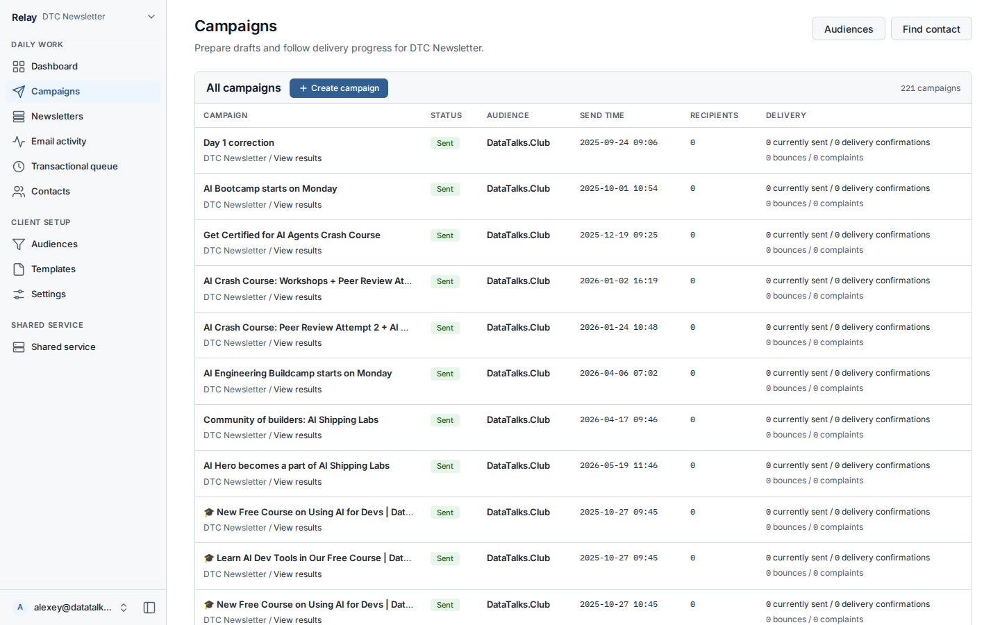

3. Relay asks what you want to create. Click **Start a newsletter**.

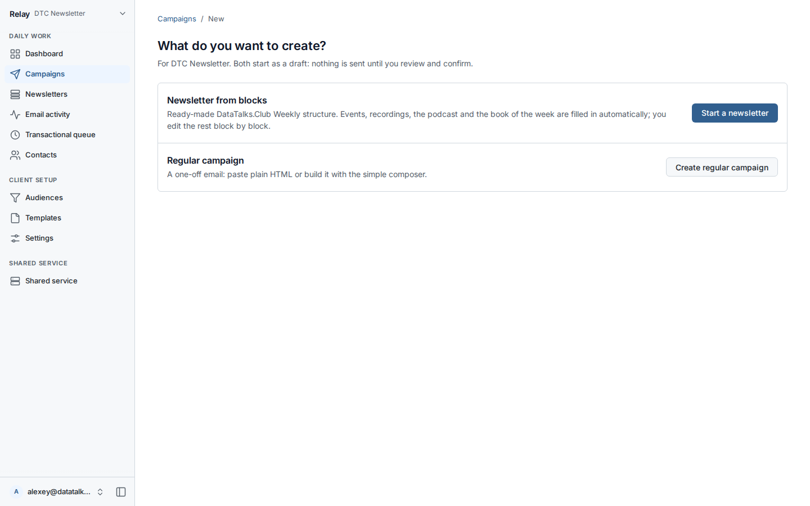

4. Check the form. Relay has already filled in the issue number, the send date
   (next Monday) and the subject. Change them if they are wrong. You can also
   change them later.
5. Click **Create newsletter**. This takes a few seconds, because Relay collects
   this week's content.

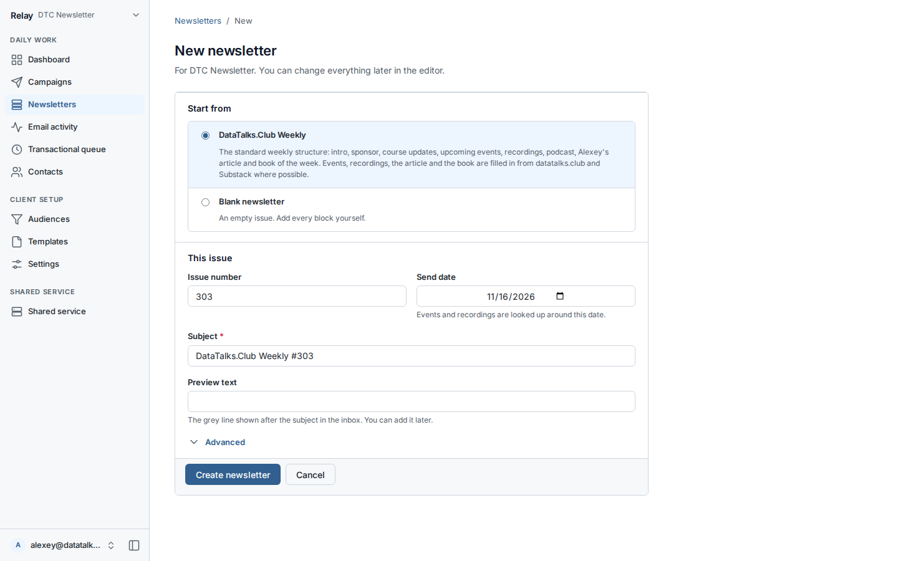

## Step 2. Look at what Relay prepared

You are now in the editor. The newsletter already has its usual blocks, in the
usual order.

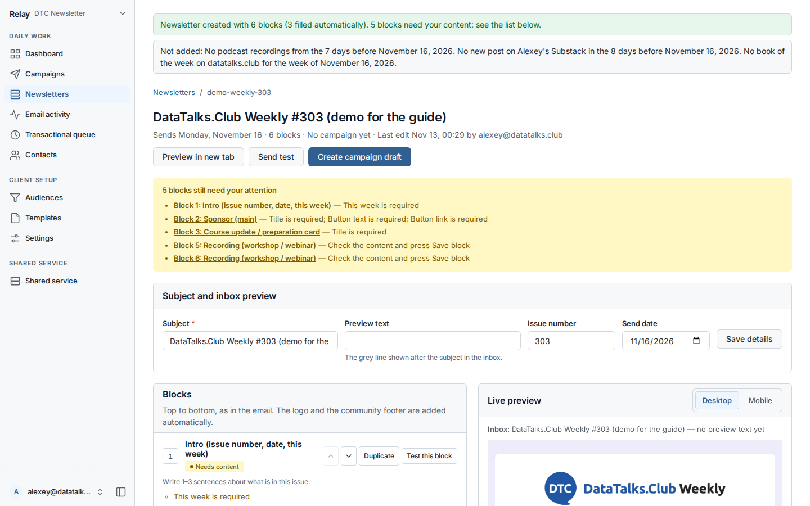

What you see:

- **The green message at the top** says how many blocks were filled in for you.
  The grey message under it lists what Relay looked for and did not find this
  week, for example "No book of the week". If one of those should be in the
  newsletter, add the block yourself (Step 5).
- **The yellow list** names every block that still needs you. Click a block
  name to jump to it. The list gets shorter as you save blocks, and turns green
  when nothing is left.
- **Subject and inbox preview** is where you change the subject line and the
  preview text (the grey line people see after the subject in their inbox).
  Click **Save details** after changing them.

  Write the subject the way previous issues did: an emoji, the headline, then
  ` | DataTalks.Club Weekly`. For example:
  `🛠️ Our new free course starts next week | DataTalks.Club Weekly`.
  Relay suggests `DataTalks.Club Weekly #303`; replace it.

  You can leave the preview text empty. Then the inbox shows the text of the
  **Intro** block, the same as in previous issues.
- **Blocks** on the left are the parts of the email, top to bottom.
- **Live preview** on the right shows the email as it looks now. Yellow dashed
  boxes mark blocks that still need content. They do not appear in the real
  email.

Each block has a small label:

| Label | Meaning |
|---|---|
| **Needs content** | You have to write or check something here. |
| **Auto-filled** | Relay filled it in from datatalks.club. Read it and correct it if needed. |
| **Ready** | Nothing left to do. |

Where the automatic content comes from:

| Block | Source |
|---|---|
| Upcoming events list | The events list on datatalks.club |
| Recording (workshop / webinar) | Last week's events that have a YouTube recording |
| Podcast episode | Last week's podcast episodes that have a recording |
| Book of the week | The book pages on datatalks.club |
| From Alexey on Data | Alexey's latest article, if it came out in the last 8 days |
| Intro | Only the issue number and date; you write the text |
| Sponsor, Course update | Nothing yet; you fill these in |

## Step 3. Edit a block

1. Find the block and click **Edit block**. Blocks that need content are
   already open.
2. Fill in the fields. Fields with a red star are required.
3. Click **Save block**.

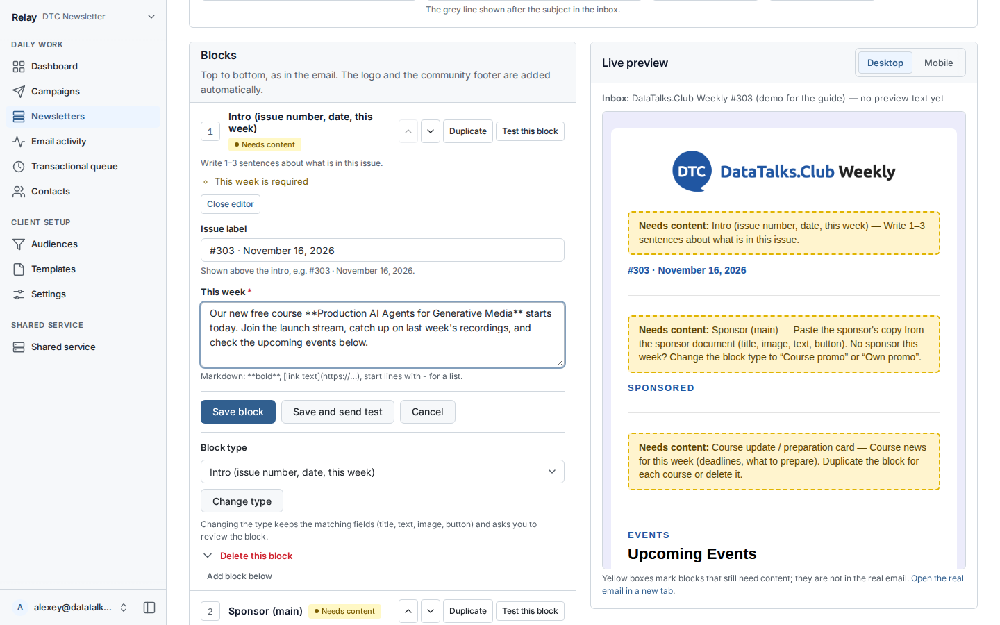

After saving, the block closes, its label turns to **Ready**, and the preview on
the right updates. You stay on the same page.

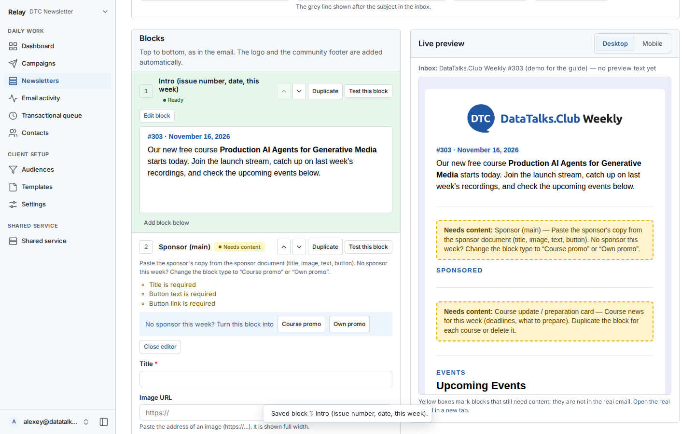

Things to know when typing:

- **Formatting.** In text fields, `**bold**` gives **bold**, and
  `[link text](https://example.com)` gives a link. Start lines with `- ` for a
  bullet list.
- **Images.** The Image URL field needs the web address of an image that is
  already online (starting with `https://`). You cannot upload a file from your
  computer here yet.
- **More fields.** Rarely used fields (section label, bullet points, closing
  text and others) are hidden under **More fields**. Click it to show them.
- **Errors.** If something is missing, the block stays open, your text is kept,
  and a red message appears next to the field.
- **Cancel** closes the block without saving.

### The sponsor block

Take the title, image, text, button text and button link from the sponsor's
document and paste them into the **Sponsor (main)** block.

If there is no sponsor this week, click **Course promo** or **Own promo** in the
blue line inside the block. The block changes type and keeps anything you
already typed.

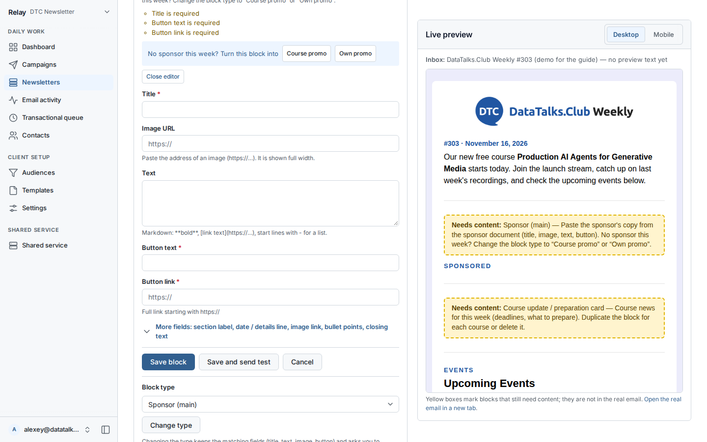

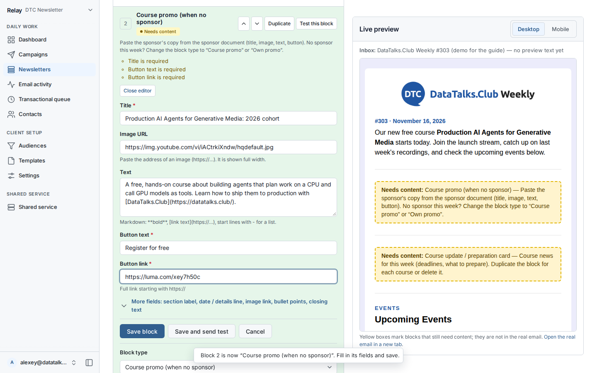

### Course updates

Each course update starts with the course banner, like in previous issues.
Put the banner address in the **Image URL** field and the course page in
**Image link**:

| Course | Image URL |
|---|---|
| AI Dev Tools Zoomcamp | `https://mcusercontent.com/0d7822ab98152f5afc118c176/images/c39d593c-3435-b19e-3a98-d2d110924dc8.png` |
| Machine Learning Zoomcamp | `https://mcusercontent.com/0d7822ab98152f5afc118c176/images/f6aee0bd-8307-6d8e-2e90-355ccb46929d.png` |
| Production AI Agents for Generative Media | `https://mcusercontent.com/0d7822ab98152f5afc118c176/images/f10f4862-ad1e-cda0-050a-21a55b64c1cf.png` |

For another course, take the banner from a previous issue or ask Alexey. The
block title (for example "Project 2") appears under the banner. If two or more
course updates follow each other, they appear one after another, without a
line between them.

### Recordings

Relay fills in the title, date, speakers, picture and link of each recording.
It cannot write the summary. Open the block, add two or three sentences in the
**Text** field, and save.

### Upcoming events

Each event is one line in this form:

```
Mon, November 16 · 5:00 PM CET · Webinar | Event title | https://link | with Speaker Name
```

Edit, add or delete lines as needed. If the list looks out of date, click
**Refresh from source** on the block to load it again from datatalks.club.

## Step 4. Move, copy or delete blocks

The buttons are in the header of every block:

- **Arrows up and down** move the block.
- **Duplicate** makes a copy right below. Use it for a second course update or
  a second recording.
- **Test this block** jumps to the test form with only this block selected.
- To delete a block: click **Edit block**, scroll to the bottom of the block,
  open **Delete this block**, tick the box and confirm.

## Step 5. Add a block

To add a block at the end, scroll below the last block, choose the type in
**Add a block at the end** and click **Add block**. To put a block in the
middle, click **Add block below** under the block it should follow.

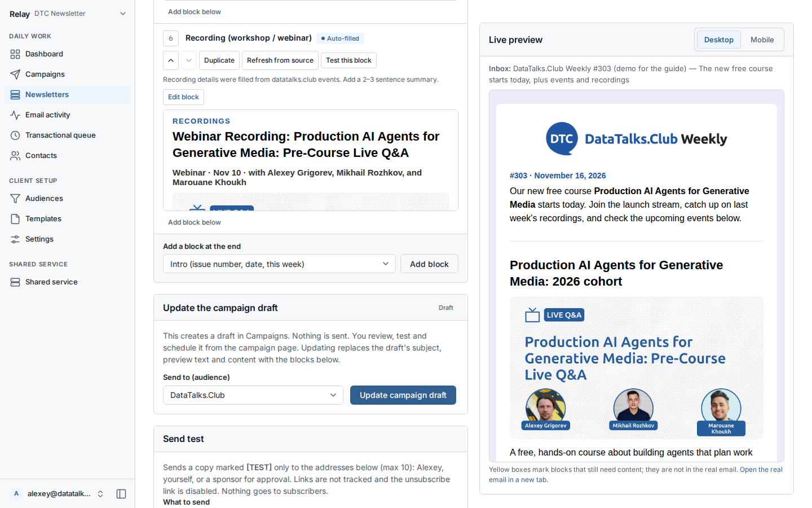

The block types match the parts of our newsletter: intro, sponsor (main and
secondary), course promo, own promo, course update, event spotlight, upcoming
events list, recording, podcast episode, From Alexey on Data, book of the week,
feature, link list and custom HTML.

## Step 6. Check the whole newsletter

When the list at the top turns green ("All blocks are ready"), read the preview
on the right from top to bottom. Use **Desktop** and **Mobile** above the
preview to see both sizes.

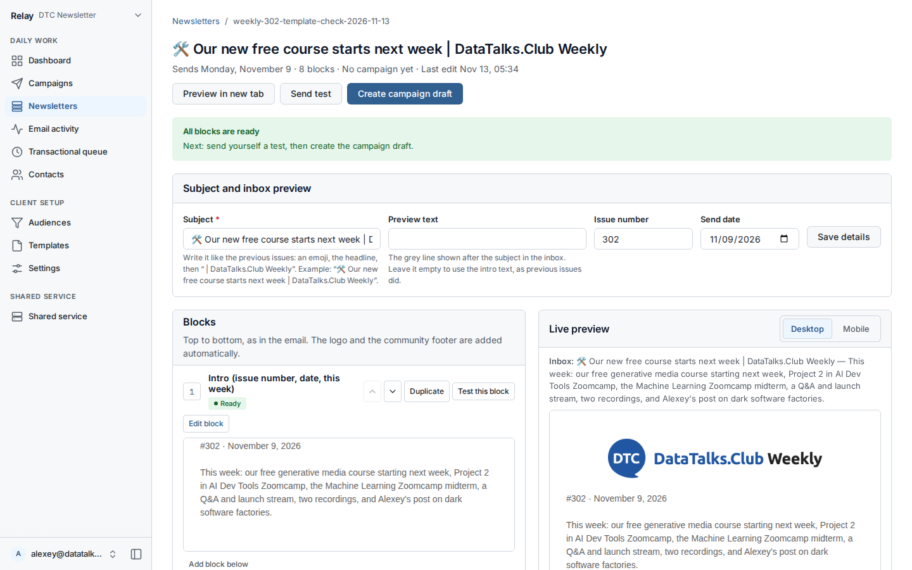

For a full-size view click **Preview in new tab** at the top of the page.

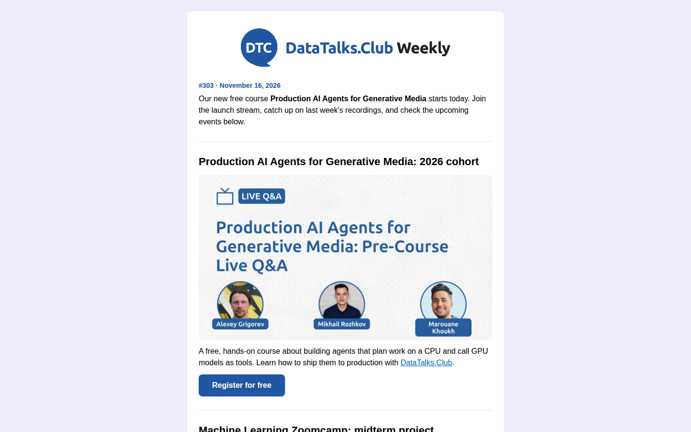

The logo at the top and the community text at the bottom are added
automatically. You do not need blocks for them.

The email uses the same template as the issues we sent before (issue #302):
the same logo, fonts, colours, buttons and footer with the social icons and
the mailing address. The sponsor, course promo and own promo blocks appear on
a light purple background. Every other block is separated by a thin grey line.

## Step 7. Send yourself a test

1. Click **Send test** at the top of the page, or scroll to the **Send test**
   section.
2. Tick your address under **Quick recipients**, or type addresses in **Other
   addresses** (for example the sponsor's, for approval). The limit is 10.
3. Click **Send [TEST] email** and wait. It can take up to 45 seconds.

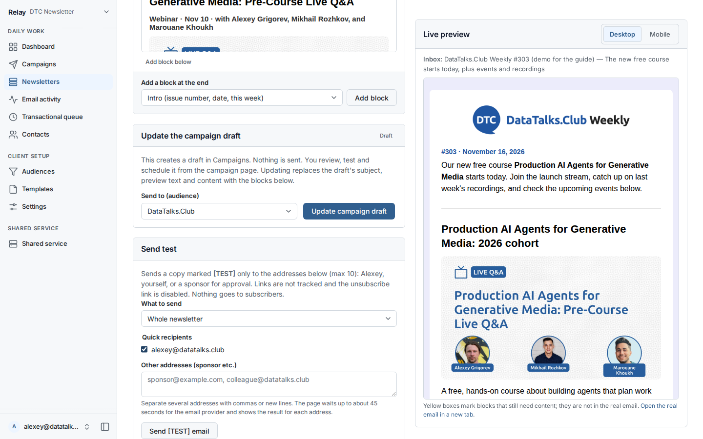

A green box shows the result for each address.

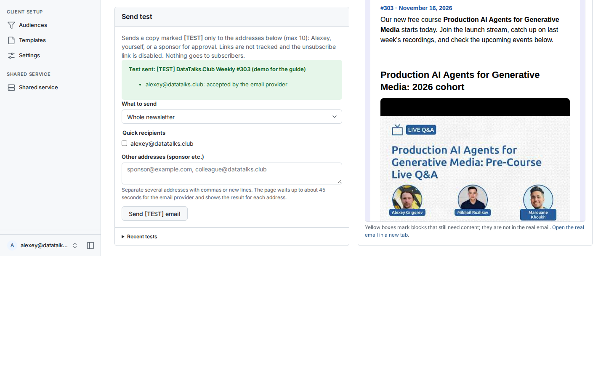

The test email has `[TEST]` at the start of the subject and a yellow banner at
the top. It goes only to the addresses you entered, never to subscribers. Links
in it are not tracked and its unsubscribe link does nothing.

To test a single block, choose it under **What to send**.

## Step 8. Create the campaign draft

When the newsletter is ready and the test looks right:

1. Scroll to **Create the campaign draft**. The audience is already set to
   **DataTalks.Club**.
2. Click **Create campaign draft**.

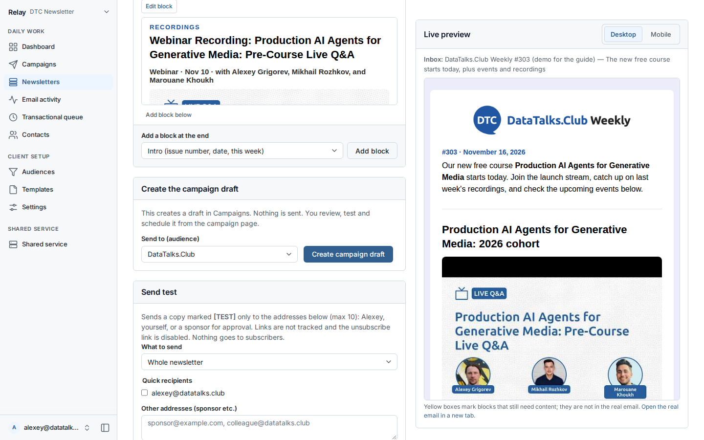

The button is switched off while any block still needs content. The section
tells you which ones.

Relay opens the campaign page with the message "Nothing has been sent".

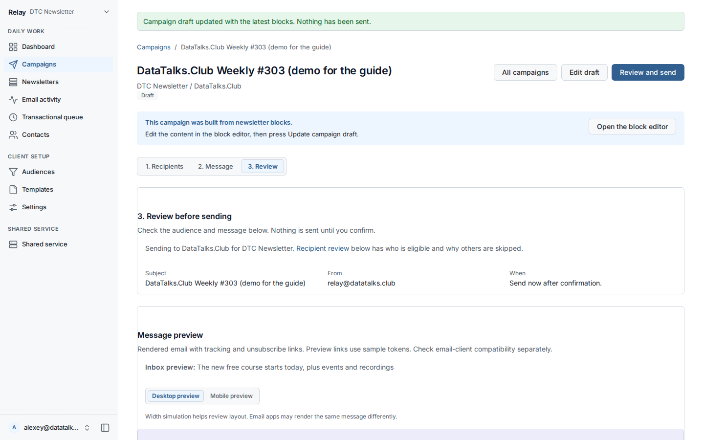

**Stop here and tell Alexey the draft is ready.** The **Review and send** button
on this page starts the real send to all subscribers. Do not click it unless
you have agreed with Alexey that you are the one sending this issue.

## Changing something after the draft exists

Do not edit the text on the campaign page. Go back to the blocks:

1. On the campaign page click **Open the block editor** (or open
   **Newsletters** in the left menu and click the issue).
2. Edit and save the blocks.
3. Click **Update campaign draft**. It replaces the content of the draft with
   the current blocks.

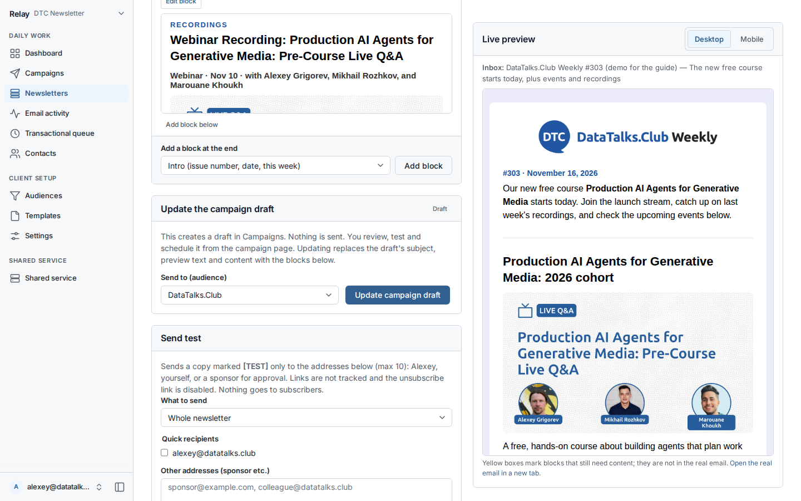

This works until the campaign is scheduled or sent. After that the blocks can no
longer change it, and Relay says so.

## Coming back later

Everything you save is kept. To continue, click **Newsletters** in the left
menu and then the issue. The list shows how many blocks each issue has, how
many still need attention, and the state of its campaign.

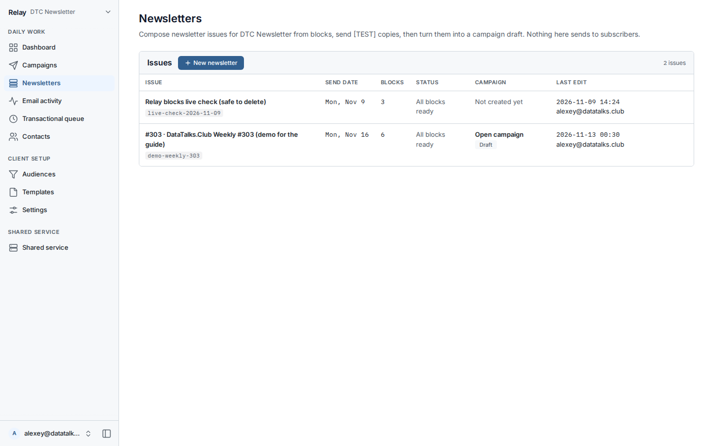

## If something goes wrong

| What you see | What to do |
|---|---|
| "The active client changed in another tab" | Choose **DTC Newsletter** in the top left corner again and repeat the action. |
| The new newsletter has no events or recordings | datatalks.club could not be reached. Open the block and click **Refresh from source**, or type the content in. |
| A block will not save | Read the red message next to the field. The usual causes are an empty required field or a link that does not start with `https://`. |
| The test result says FAILED or NO ANSWER | Look at **Recent tests** below the form before sending again, so nobody gets two copies. If it keeps failing, tell Alexey. |
| **Create campaign draft** is greyed out | Some block still needs content. Use the yellow list at the top of the page. |
| "The linked campaign was already queued, scheduled or sent" | The issue has gone out or is scheduled. Ask Alexey before changing anything. |
| "Another campaign of this client already uses the key" | A campaign with the same key exists (for example one made by hand). Tell Alexey; do not create a second one. |
